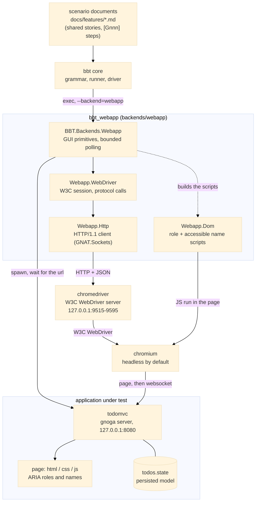

<!--
 bbt, the black box tester (https://github.com/LionelDraghi/bbt)
 SPDX-License-Identifier: MIT OR Apache-2.0 WITH LLVM-exception
 SPDX-FileCopyrightText: 2026 Lionel Draghi
-->

# ToDoMVC — web implementation

Browser application, served by an embedded gnoga HTTP server and
driven through the webdriver GUI backend (`--backend=webapp`).

- builds a `./todomvc` binary (`alr build`) that serves the page on
  `http://127.0.0.1:8080` (gnoga's `--gnoga-port=<n>` switch
  overrides the port; the serving URL is also printed on the
  standard error),
- satisfies the [behavior spec](../ToDoMVC.md) and its
  [witness stories](../docs/features), with the same model, the same
  widget naming contract and the same storage format as the
  [GTK 4 implementation](../gtk4/README.md),
- exposes the [widget naming
  contract](../ToDoMVC.md#widget-naming-contract) through ARIA: each
  control carries its role (native HTML element, or `aria-pressed`
  for the filter toggles) and its accessible name (`aria-label`,
  or the element's own text), so that the accessibility tree holds
  exactly what the scenarios target.

## The test chain



| Component | Role | Where |
|---|---|---|
| `bbt` core | parses the documents, runs the steps, dispatches the GUI primitives | repository root |
| `bbt_webapp` | the backend: `Launch`, `Window_Appears`, `Press_Widget`, `Type_Into`, `Enter_Into`, ... on the page, with its own HTTP/JSON to the driver | [backends/webapp](../../../backends/webapp) |
| `chromedriver` | the W3C WebDriver implementation: launches and steers the browser | `PATH` |
| the browser | renders the page, runs the DOM scripts, dispatches the clicks and keys | `PATH` |
| `todomvc` | the witness application: serves the page, owns the model and the state file | this directory |

Nothing between the backend and the browser is bbt-specific: the
vocabulary's "window" is the page (G005), its role + accessible name
lookups are computed on the DOM (G015), and the commands reach the
browser through the driver — no accessibility bus is involved.

## Build and run

```
alr build
./todomvc            # serves http://127.0.0.1:8080
```

The page assets are served from this directory, next to the binary
(gnoga resolves `html/`, `css/` and `js/` from the executable's
directory): `html/boot.html` is the boot page, `css/style.css` the
styling, `js/boot.js` and `js/jquery.min.js` the gnoga client, taken
from the gnoga crate (`components/basic/js/`).

## Scenarios

`scenarios/` links the shared witness stories
(`../docs/features`) — one suite per backend, the same expectations:
`make check` runs them with `--backend=webapp`
(`make check STORY=add_a_task.md` restricts the run to one story).

## Notes for the webdriver backend users

- the app under test is a **server**: the runner launches
  `./todomvc`, then points the browser at the printed URL (default
  port 8080); the page is the spec's window (G005: the page and its
  document, the document title being `ToDoMVC`);
- closing the page does not stop the application: it keeps serving
  until the runner ends the process (G095 leaves windowless
  applications out of the close step's scope);
- the todo rows are `listitem` elements named with the todo title:
  activating one (a click on the item) selects the todo;
- the edit input (`Edit todo`) only exists while an edition is open:
  validating it (Enter) and leaving it both commit the edition, as
  does selecting another todo;
- the filters are `button` elements carrying `aria-pressed`
  (`true` on the active one).

The backend is configured through the environment:

| Variable | Meaning | Default |
|---|---|---|
| `BBT_WEBAPP_URL` | the page the backend navigates to, and waits for | `http://127.0.0.1:8080` |
| `BBT_WEBAPP_DRIVER` | the driver executable | `chromedriver` in the `PATH` |
| `BBT_WEBAPP_BROWSER` | the browser binary the driver launches | first of `chromium`, `chromium-browser`, `google-chrome`, `chrome` in the `PATH` |
| `BBT_WEBAPP_BROWSER_ARGS` | extra browser arguments, blank separated | none |
| `BBT_WEBAPP_HEADLESS` | `0` shows the browser window | headless |

`--no-sandbox` is the usual `BBT_WEBAPP_BROWSER_ARGS` value when the
suite runs as root (containers, CI).

## Persistence

State file `todos.state` in the current directory: 
one `U <title>` (undone) or `D <title>` (done)
line per todo, and a `F <filter>` line for the active filter. Written
on every model change (not on exit), so closing the page never loses
an acknowledged change. An edition in progress is not persisted.
