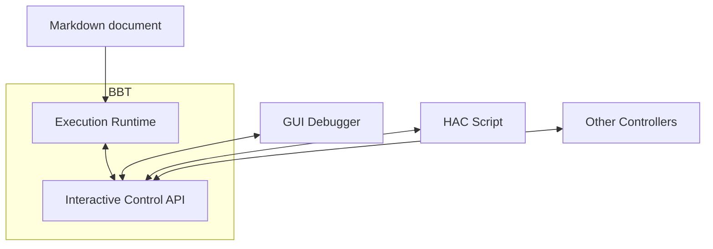
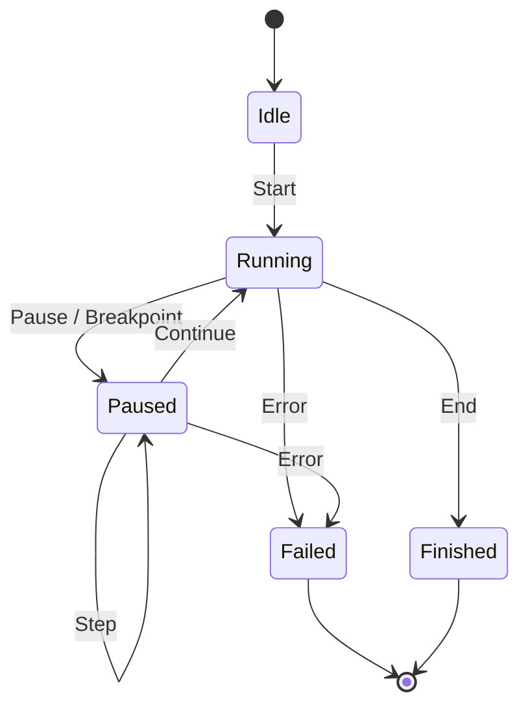
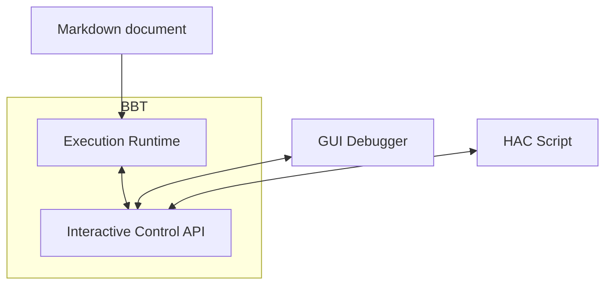
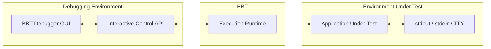
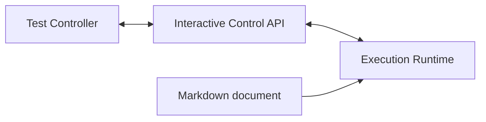

# Interactive Execution and Debugging

> **Status — partially implemented (v0.6.1-dev).**
>
> Done: controllable execution (halt points before each step,
> scenario, feature and file), execution events carrying stable
> source locations, the Step and Continue commands (Continue with a
> scope, and run to the end in the absence of breakpoints), and the
> first control API client: the web debugger of `bbt --gui` (embedded
> gnoga server), merged from the interactive_execution branch.
>
> Two deviations from the text below: the GUI is web based (gnoga)
> rather than native - the terminal sharing argument stands, and the
> embedded server keeps `--gui` self contained, with the browser as
> the display; and the command set is Step / Continue only, the
> proposal's other commands being gated on breakpoint support.
>
> Remaining: breakpoints (Set_Breakpoint / Clear_Breakpoint, their
> GUI support, and the "Continue until the next breakpoint"
> semantics), the explicit Pause command, step output and error
> visualisation in the debugger, an automated control API test, and
> the HAC scripting client.

## Motivation

BBT makes Markdown directly executable.

Today, execution is essentially sequential: BBT reads a document, identifies executable steps, executes them, and reports their results.

The next logical step is to make this execution **observable and controllable while it is running**.

The initial use case is a debugger-like interface where the user can:

- see the Markdown document being executed;
- see the current executable step highlighted;
- execute step by step;
- continue execution;
- pause execution;
- set and remove breakpoints;
- observe actions and their results as they happen.

This should not, however, be designed as a GUI feature.

It should be designed as a **BBT runtime capability** on top of which different controllers can be implemented.

## Principle

Separate three concerns:

1. the Markdown document being executed;
2. the BBT execution and control runtime;
3. the clients observing and controlling that execution.



The Markdown document is the **input being executed**.

The GUI, HAC, or other possible clients are **controllers** of that execution.

The BBT execution engine must not depend on any particular controller.

Instead, it exposes:

1. **execution events** describing what is happening;
2. **commands** controlling execution.

A GUI is therefore only one possible client of this interface.

## Execution Events

The engine should expose a small set of events such as:

- `Before_Step`
- `After_Step`
- `Output`
- `Error`
- `Execution_Started`
- `Execution_Paused`
- `Execution_Finished`

An event associated with a Markdown step should contain enough information to map execution back to the source document, for example:

```text
source file
source position / line
step identifier
step text
execution status
result
```

Source positions are important: the debugger should be able to highlight the Markdown itself rather than maintain a second representation of the scenario.

## Execution Commands

The runtime should accept commands such as:

```text
Step
Continue
Pause
Set_Breakpoint
Clear_Breakpoint
```

Potential future commands could include:

```text
Run_To
Restart
Stop
```

The initial implementation should remain deliberately small.

## Runtime States

A minimal execution state machine could be:



Breakpoints cause the runtime to enter `Paused` before executing the corresponding Markdown step.

A `Step` command executes the current step and pauses again before the next executable step.

A `Continue` command resumes normal execution until the next breakpoint, failure, explicit pause, or end of execution.

## GUI

A graphical interface could provide a familiar debugger experience.

The main view would display:

- the Markdown document;
- the current executable step;
- breakpoints;
- execution status;
- output and errors;
- basic debugger controls such as Step, Continue and Pause.

Clicking beside an executable Markdown line could toggle a breakpoint.

The Markdown remains the central artefact.

There is no separate debugger script or generated representation that the user needs to understand.

## Why Not a Terminal UI?

A terminal UI initially looks attractive because it would be extremely lightweight and could use ANSI terminal capabilities.

BBT already uses terminal capability detection, so this would also fit naturally with the existing environment.

However, BBT scenarios frequently test programs whose observable behaviour itself uses:

- standard output;
- standard error;
- terminal interaction;
- ANSI sequences;
- interactive command-line interfaces.

A BBT debugger sharing the same terminal would therefore interfere with the very environment being tested.

This is a significant architectural issue rather than merely an ergonomic inconvenience.

The application under test should be allowed to behave as though it owns its terminal.

Therefore a separate GUI is preferable for interactive debugging.

## Standalone GUI Mode

The simplest user experience could remain:

```console
bbt --gui scenario.md
```

BBT would launch its graphical interface and execute the scenario under debugger control.

There is no requirement for a browser, external server, or permanently installed development environment.

The goal should be a small, self-contained executable rather than a large web-based desktop application.

The GUI toolkit should therefore preferably be native and lightweight.

The choice of toolkit remains open.

## No Dependency on the GUI

The important architectural decision is:

> `--gui` must be a client of the interactive execution API, not the implementation of interactive execution itself.

This distinction makes interactive execution useful independently of the graphical debugger.



This also makes the control interface independently testable.

## HAC Integration

A particularly interesting possibility is to use HAC as a scripting client.

A HAC program could control BBT execution:

```ada
Set_Breakpoint (...);

Continue;

if Current_Step = ... then
   ...
end if;

Step;

Continue;
```

This would make it possible to write scenarios which inspect or control another BBT execution without coupling the execution engine itself to HAC.

HAC and the graphical debugger therefore become two clients of exactly the same execution-control abstraction.

This also opens the possibility of using the API for automated debugging, experimentation, or higher-level orchestration.

## Testing Applications Using a Terminal

The separation between the debugger and the execution environment becomes particularly important when BBT tests command-line or interactive terminal applications.

Conceptually, those are two separate environments:



The debugger observes and controls BBT.

It does not share the application's terminal and should not become part of the environment that BBT is testing.

This preserves the behaviour of the application under test as closely as possible to normal execution.

## Proposed Implementation Strategy

The implementation should proceed incrementally.

### 1. Make Execution Controllable

Refactor the execution loop so that execution can stop between executable Markdown steps.

No GUI is required at this stage.

The objective is simply to make the current sequential execution externally controllable.

### 2. Introduce Execution Events

Expose the current source location, step, status, and result.

The source location should provide a stable mapping between execution and the original Markdown document.

### 3. Introduce Commands

Initially support only:

```text
Step
Continue
Pause
Set_Breakpoint
Clear_Breakpoint
```

Avoid building a complete debugger protocol before concrete needs appear.

### 4. Validate With a Minimal Controller

Before implementing a graphical interface, exercise the API directly from Ada tests or a minimal controller.

For example:



This validates that the execution model is genuinely independent from its user interface.

### 5. Add `--gui`

Implement the graphical debugger purely as a client of the control interface.

The GUI should contain as little execution logic as possible.

Its responsibilities are primarily:

- display;
- navigation;
- breakpoint management;
- sending execution commands;
- visualising execution events.

### 6. Experiment With HAC

Once the interface is stable, expose the same primitives through the HAC binding.

The HAC experiment is also a useful architectural test: if HAC can drive the runtime without knowledge of the GUI, the separation is working as intended.

## Design Constraints

The main architectural rule should remain:

> **Interactive execution belongs to BBT. The graphical debugger does not.**

The BBT runtime knows how to:

- execute;
- pause;
- continue;
- step;
- manage breakpoints;
- report its state.

It does not know how those capabilities are presented to the user.

The GUI knows how to display and control an execution.

HAC knows how to script and control an execution.

Neither defines how BBT executes Markdown.

This preserves BBT's original philosophy:

> **Markdown is the specification and the executable artefact.**

Interactive debugging adds observability and control around that execution without introducing another representation of the scenario or coupling execution to a particular user interface.
